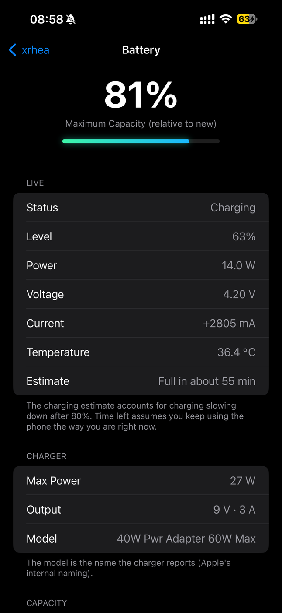
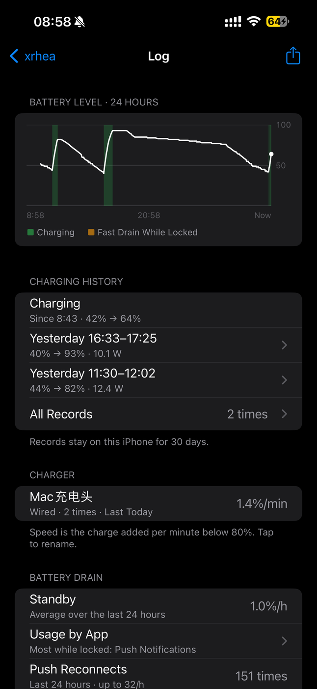
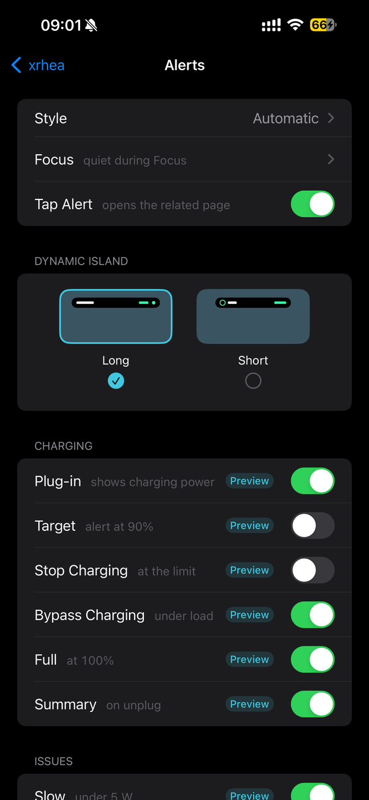

# xrhea

**A battery and charging tweak for jailbroken iOS 17** · [简体中文](README.zh-CN.md)

Rhea, Saturn's moon, is the mother of the gods in Greek myth: the source of their strength. The battery is your phone's. xrhea looks after it: detailed battery readings, a real charge limit, a battery log that shows where the charge goes, and short, readable alerts from the Dynamic Island. Written from scratch.

<p align="center">
  
  
  
</p>

Objective‑C / Logos, built with Theos, for **roothide** jailbreaks. Made for iOS 17 and **only tested on iOS 17.3.1**; some features may not work on other versions. The settings UI is in English and Chinese: it follows the system language, or pick one under About › Language.

## Features

**Battery details**
- Maximum capacity against a new battery, with a progress bar.
- Live: status, level, power, voltage, current, temperature and an estimate (time to full / to your limit while charging, time left on battery). While charging, power is what the charger delivers into the phone, so it matches a USB power meter.
- Charger: max power, negotiated voltage and current, model name.
- Capacity (full charge, design, current charge) and cycle count.
- A ⚠️ on readings that need attention (worn battery, too hot, charger stuck at 5 V, charging too slowly, draining fast), each with what to do about it, plus a short guide to reading the numbers.

**Log**
- 24-hour battery level chart, with charging and fast standby drain highlighted.
- Charging history for the last 30 days: time, level, charge added, average and peak power, peak temperature, charger, and how it ended (unplugged / held at the limit / full). Each session has its own level and power chart.
- Chargers: the measured charging speed of each one, how often it was used, and a name you can set.
- Battery drain: average standby drain, usage by app (all, and while locked) from the system battery log, push-notification reconnects and network wakes over the last 24 hours. Frequent push reconnects (often caused by a proxy or VPN) are flagged with the likely causes.
- Event log: key actions by xrhea (charging stopped / resumed, Low Power Mode switched) plus plug-ins, screen locks and boot time; at startup it also quotes the first line of any new system crash log (panic), to help track down restarts. Kept on the phone only.
- Export: one Markdown file with all of the above (including the last 300 event log entries), ready to save or hand to an AI for analysis.

**Charge limit**
- Stop charging at 60–90%. While plugged in, the charger powers the phone directly and the battery neither charges nor drains; charging resumes once the level drops below the limit by the amount you choose.
- Stops about 1% early when charging fast, so it never goes over.
- When you plug in, asks whether to keep the limit or charge to 100% this time (handy before heading out); the limit comes back when you unplug.
- Scheduled full charge: holds at the limit overnight and starts charging in time to reach 100% by the time you set, using the charging speed it has learned for that charger.
- Reminds you to charge fully once a month to keep the battery reading accurate.
- Runs as a small root daemon. Turning the limit off, uninstalling, or restarting the phone resumes normal charging.

**Optimization**
- Status at the top of the page: what's active right now and the readings behind it.
- Heat protection: when the battery reaches the set temperature (30–50 °C; 40 °C recommended wired, 37 °C wireless) while charging, either stop charging or switch to intermittent charging (3 minutes off, 3 minutes on, roughly halving the average current). Resumes 3 °C below the set temperature.
- Bypass while gaming: when the phone's 1-minute average power draw is above a set value (4 W recommended), the battery stops charging and the charger powers the phone directly, which keeps it cooler. Charging resumes when the load drops. Not used below 20%.
- Background drain alert: checks the system battery log every hour and tells you when one app takes more than a set share of the drain for 3 locked hours in a row.

**Low Power Mode**
- Turn Low Power Mode on below a set level, off once charged to a set level, on while the phone is locked (off again when you unlock), and on while charging (off again when you unplug).
- Keep the 120 Hz refresh rate in Low Power Mode on ProMotion models; every other power saving stays on. This part runs inside backboardd and only changes how the display reads the Low Power Mode state.

**Alerts**
- Shown from the Dynamic Island, as a long pill like the one iOS shows when you plug in (text on the left, the value on the right) or a shorter one; phones without a Dynamic Island get a banner.
- Charging: plugged in (charging power, or the scheduled start and finish times), target level reached, limit reached, bypass while gaming started, fully charged, charging summary on unplug, heat protection.
- Issues: slow charging, charging slowed by heat, loose cable, plugged in but not charging, battery hot, charging in the cold.
- Usage: battery draining while locked, low battery at bedtime, high power draw, apps draining in the background, and a weekly summary on Monday morning.
- Each alert has its own switch and a **Preview** button that shows it with your phone's current readings.
- Quiet during Focus, with your own list of alerts that still come through (by default only hot and cold).
- Tap an alert to open the related page (battery details, or the log for the weekly summary).
- Each alert shows at most once every 30 minutes.

**About page**
- Language (System / 中文 / English), check GitHub for a new version, report an issue, copy debug info (versions, device model, changed settings and recent plug-in and alert records), restart history (boot times and system crash reasons, no apps or usage), charging self-test (unplug and plug in when asked, and it tells you whether the plug-in alert works and why not if it doesn't), donate, reset all settings.

Settings live in Settings › xrhea.

## Known issue: occasional restarts on iPhone 15 Pro

iPhone 15 Pro / 15 Pro Max (A17 Pro) sometimes restart on their own with this crash reason:

```
AOP Unknown exception … low_latency(7) OUTBOX3 not ready
```

This is a firmware problem in Apple's AOP coprocessor (it runs the always-on sensor features such as Raise to Wake), **not something xrhea causes**:

- 15 Pro users without a jailbreak or any tweaks have reported the same crash ([Apple Community](https://discussions.apple.com/thread/255519694), [MacRumors](https://forums.macrumors.com/threads/iphone-15-pro-random-restart-kernel-panic.2405141/)).
- On the author's two phones (iOS 17.2.1 and 17.3.1) the crash happened at exactly the same address, and on one of them every active xrhea feature was off. Stress-testing the most suspicious path (switching Low Power Mode with 120 Hz kept) 208 times in a row did not reproduce it.
- xrhea only talks to the battery fuel gauge (AppleSmartBattery). It never touches sensors, location, brightness or the display, so it can't reach the AOP.

xrhea can't fix this firmware problem. For jailbroken phones the pain is having to re-jailbreak after the restart. What you can do:

- Check the cause in Settings › xrhea › About › Restart History; this issue is labeled "AOP coprocessor firmware crash".
- An occasional restart needs no action and does not harm the hardware.
- If it happens often (several times a day), have the sensor hardware checked, such as the proximity sensor flex cable.
- Updating iOS may bring fixed firmware, but you lose the jailbreak.
- You can try turning off Raise to Wake, Always On Display and "Hey Siri" to give the AOP less work (unverified).

If your crash reason is different, please [report it](https://github.com/oryanfang/xrhea/issues) with your Restart History.

## Privacy

xrhea reads the battery's own readings, the system battery log and the first line of system crash logs (for the event log) on the phone and keeps everything there. It collects nothing and sends nothing; the only network request is the About page checking GitHub for a new version when you open it. The log export is created only when you tap it and goes only where you share it; it includes which apps used the battery. The battery's and charger's serial numbers are never shown, saved or exported.

## Install

Add the source `https://oryanfang.github.io/repo/` in Sileo or Zebra and install **xrhea**. Or download the `.deb` from [Releases](https://github.com/oryanfang/xrhea/releases).

roothide only (package architecture `iphoneos-arm64e`). For rootless / rootful you need to change the packaging yourself, see [BUILDING.md](BUILDING.md).

## Support

xrhea is free. If it helps you, you can buy the author a coffee with WeChat: WeChat accepts Visa and Mastercard. On a phone, save the image, then in WeChat tap Scan › Album and choose it. A star on the repository helps too.

<p align="center"></p>

## License

Licensed under the [PolyForm Noncommercial License 1.0.0](LICENSE): free for personal study, research and other noncommercial use; commercial use is not allowed.
